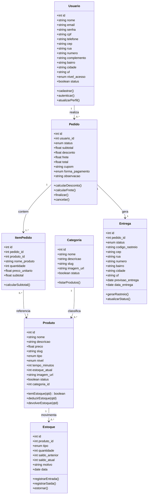
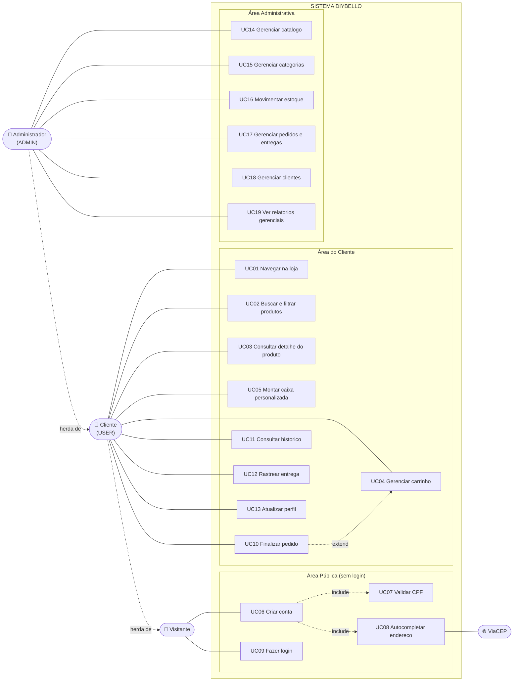
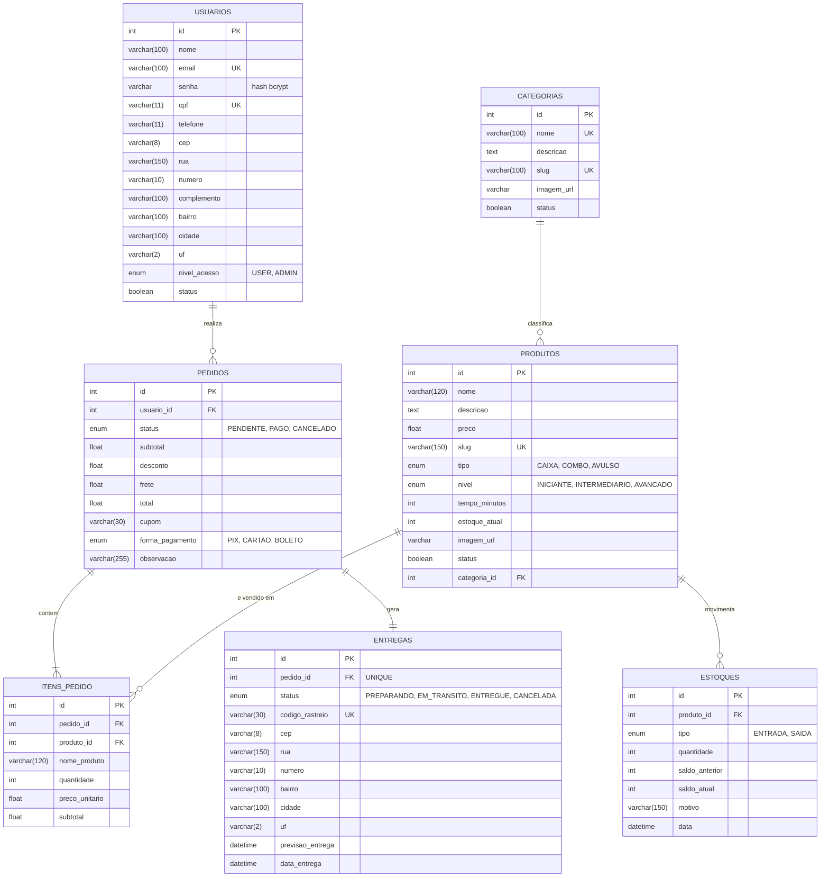

# DIYBELLO — Diagramas de Engenharia

> Os diagramas abaixo estão escritos em **Mermaid**. Para exportar em `.png`,
> cole o bloco de código em [mermaid.live](https://mermaid.live) e use *Actions → PNG*,
> ou instale a extensão *Markdown Preview Mermaid Support* no VS Code e capture a tela.

---

## 1. Diagrama de Classes (UML)

### Cardinalidades

| Relacionamento | Cardinalidade | Chave estrangeira | Ao apagar o pai |
|---|---|---|---|
| Usuario → Pedido | 1 : N | `pedidos.usuario_id` | CASCADE |
| Pedido → ItemPedido | 1 : N | `itens_pedido.pedido_id` | CASCADE |
| ItemPedido → Produto | N : 1 | `itens_pedido.produto_id` | RESTRICT |
| Pedido → Entrega | 1 : 1 | `entregas.pedido_id` (UNIQUE) | CASCADE |
| Categoria → Produto | 1 : N | `produtos.categoria_id` | RESTRICT |
| Produto → Estoque | 1 : N | `estoques.produto_id` | CASCADE |

---

## 2. Diagrama de Casos de Uso

---

## 3. Modelo Entidade-Relacionamento (banco)

---

